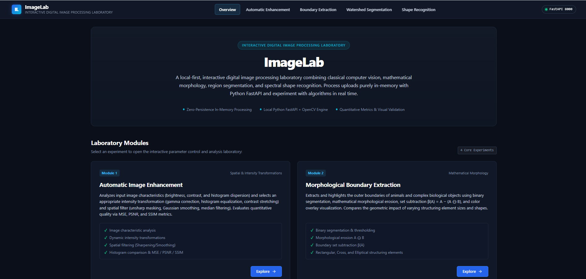
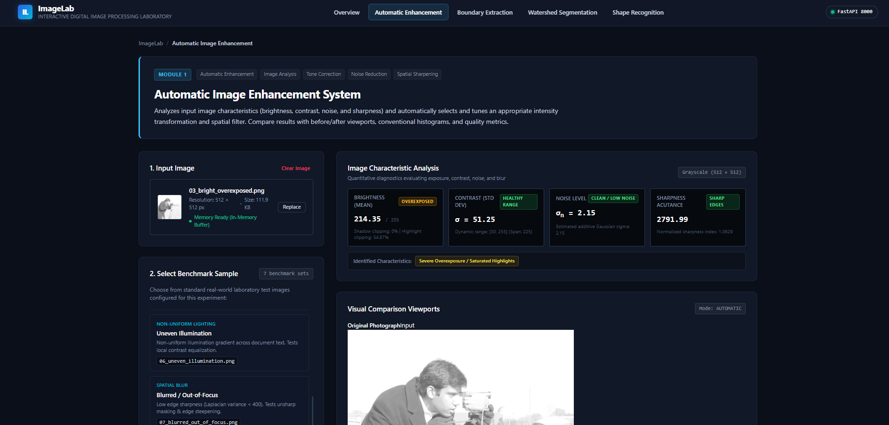
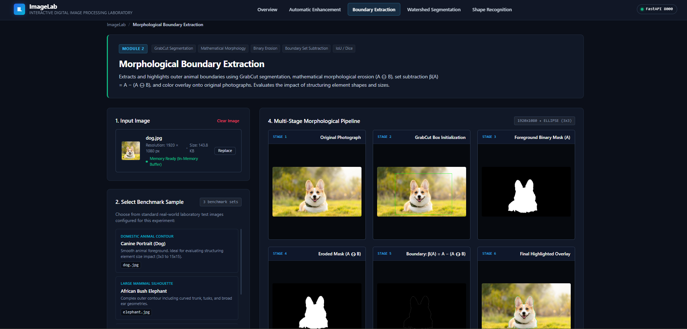
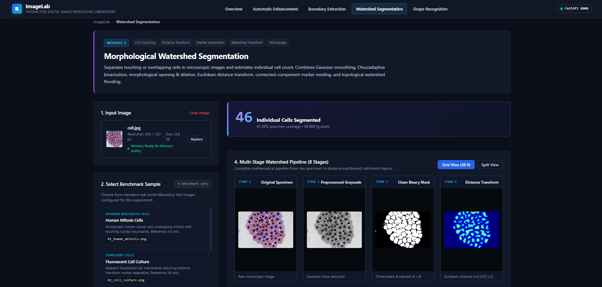
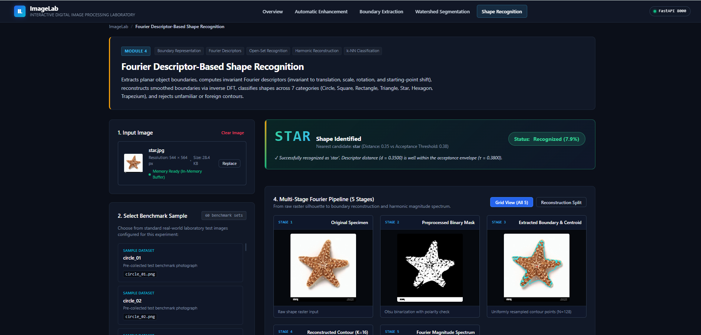

<div align="center">

# ImageLab — Interactive Digital Image Processing Laboratory

**A local-first, full-stack Digital Image Processing (DIP) laboratory built with Python (FastAPI, OpenCV, NumPy, scikit-image) and React 18 (Vite).**

[](https://www.python.org/)
[](https://fastapi.tiangolo.com/)
[](https://opencv.org/)
[](https://reactjs.org/)
[](https://vitejs.dev/)

[Overview](#overview) • [Visual Showcase](#visual-showcase) • [Architecture](#system-architecture) • [Quick Start](#local-installation--setup) • [Algorithms](#dip-algorithm-formulations--principles) • [API Reference](#api-reference) • [Testing](#running-integration--quality-tests)

</div>

---

## Overview

**ImageLab** is an academic, transparent, and interactive Digital Image Processing platform designed for experimenting with, benchmarking, and visualizing foundational computer vision algorithms. Every processing stage is executed strictly **in memory** with zero permanent disk persistence for user uploads, and every module surfaces intermediate mathematical representations alongside quantitative evaluation metrics.

### Core Modules

| # | Module | Key Techniques | Quantitative Metrics |
| :-: | :--- | :--- | :--- |
| **1** | **Automatic Image Enhancement** | Quantitative defect diagnostics, Power-Law Gamma, Local Histogram Equalization (CLAHE), Weighted Averaging, Median Filtering, Unsharp Masking | MSE, PSNR (dB), SSIM, 256-Bin Bar Histograms |
| **2** | **Morphological Boundary Extraction** | SLIC Manifold-Ranking Saliency + GrabCut segmentation, $\beta(A) = A - (A \ominus B)$, Rectangle/Ellipse/Cross structuring elements | Foreground/Boundary Pixel Counts, Connected Components, IoU & Dice |
| **3** | **Morphological Watershed Segmentation** | 8-stage pipeline, Otsu/Adaptive thresholding, Morphological Opening, Exact Euclidean Distance Transform, Marker-Controlled `cv2.watershed` | Estimated Cell Count, Mean Area, Per-Region Table, IoU & Dice |
| **4** | **Fourier Descriptor Shape Recognition** | Uniform arc-length resampling ($M=128$), 1D DFT, Translation/Scale/Rotation invariance, $\sqrt{k}$ harmonic weighting, IDFT reconstruction, Open-set rejection ($\tau_c$) | Classification Confidence, Descriptor Distance, Confusion Matrix, 7-Class Accuracy |

---

## Visual Showcase

### Application Overview

*Figure 1: ImageLab landing dashboard providing direct access to all four DIP laboratories.*

### Module Demonstrations

<table>
  <tr>
    <td width="50%">
      <strong>1. Automatic Image Enhancement</strong><br/>
      <em>Characteristic analysis, adaptive enhancement, and conventional 256-bin bar histograms.</em>
      <br/><br/>
      
    </td>
    <td width="50%">
      <strong>2. Morphological Boundary Extraction</strong><br/>
      <em>Saliency-guided GrabCut foreground mask, erosion, and β(A) = A − (A ⊖ B) overlay.</em>
      <br/><br/>
      
    </td>
  </tr>
  <tr>
    <td width="50%">
      <strong>3. Morphological Watershed Segmentation</strong><br/>
      <em>Distance transform, sure foreground/background markers, and labeled cell regions.</em>
      <br/><br/>
      
    </td>
    <td width="50%">
      <strong>4. Fourier Descriptor Shape Recognition</strong><br/>
      <em>Invariant descriptor spectrum, IDFT contour reconstruction, and open-set classification.</em>
      <br/><br/>
      
    </td>
  </tr>
</table>

---

## System Architecture

ImageLab uses a decoupled client-server architecture with stateless REST communication:

```text
+-----------------------------------------------------------------------------------------+
|                                    React 18 Frontend                                    |
|                          (Vite + React Router + Custom Dark UI)                         |
+--------------------+---------------------+--------------------+-------------------------+
                     |                     |                    |
        POST /analyze| & /process          |       GET /samples | (JSON / Raw Images)
                     v                     v                    v
+-----------------------------------------------------------------------------------------+
|                                   FastAPI REST Backend                                  |
|                             (Uvicorn ASGI @ 127.0.0.1:8000)                             |
+--------------------+---------------------+--------------------+-------------------------+
| Enhancement Route  |   Boundary Route    |  Watershed Route   |  Fourier Descr. Route   |
| /api/enhancement/* |   /api/boundary/*   |   /api/watershed/* |     /api/fourier/*      |
+--------------------+---------------------+--------------------+-------------------------+
|                                  DIP Processing Layer                                   |
|     OpenCV (cv2)   |   NumPy & SciPy     |    scikit-image    |      scikit-learn       |
+--------------------+---------------------+--------------------+-------------------------+
|                                  In-Memory Data Model                                   |
| Upload Bytes -> cv2.imdecode() -> DIP Transform -> cv2.imencode() -> Base64 Data URI   |
|                       (Zero Temporary Files Persisted to Disk)                          |
+-----------------------------------------------------------------------------------------+
```

### Project Structure

```text
ImageLab/
├── backend/
│   ├── app/
│   │   ├── api/                 # FastAPI route handlers (enhancement, boundary, watershed, fourier, samples)
│   │   ├── services/            # Core DIP algorithms & mathematical pipelines
│   │   ├── utils/               # In-memory image I/O validation & quantitative metrics (MSE, PSNR, SSIM, IoU)
│   │   ├── config.py            # Application settings & sample dataset paths
│   │   └── main.py              # FastAPI app entrypoint & CORS middleware
│   ├── data/samples/            # Local offline benchmark datasets & segregated ground-truth masks
│   ├── run.py                   # Uvicorn development server launcher
│   ├── run_full_system_test.py  # Master end-to-end quality & integration suite
│   └── requirements.txt         # Python dependencies
├── frontend/
│   ├── src/
│   │   ├── components/          # Reusable UI components (HistogramComparison, ImageUploadSection, SampleSelector)
│   │   ├── pages/               # Module pages (Home, EnhancementPage, BoundaryExtractionPage, WatershedPage, ShapeRecognitionPage)
│   │   ├── services/api.js      # Centralized Fetch API client with timeout handling
│   │   └── styles/App.css       # Custom dark-theme design system
│   ├── package.json             # Node dependencies & Vite scripts
│   └── vite.config.js           # Vite dev server & /api proxy configuration
└── docs/
    └── images/                  # Screenshots and visual assets for README.md
```

---

## Technology Stack & Dependencies

### Backend (`backend/requirements.txt`)
- **Python 3.10+**
- **FastAPI (`>=0.110.0`)** & **Uvicorn (`>=0.28.0`)** — Asynchronous REST API & ASGI server
- **OpenCV (`opencv-python-headless >=4.9.0.80`)** — Image transformations, morphology, GrabCut, watershed, contours
- **NumPy (`>=1.26.0`)** & **SciPy (`>=1.12.0`)** — Vectorized arrays, FFT/DFT, spatial filtering
- **scikit-image (`>=0.22.0`)** — SLIC superpixels, SSIM, benchmark datasets
- **scikit-learn (`>=1.4.0`)** — Nearest-neighbor matching, confusion matrices, classification metrics
- **Matplotlib (`>=3.8.0`)** — In-memory harmonic power spectra & contour plots
- **Pydantic (`>=2.6.0`)** & **python-multipart (`>=0.0.9`)** — Validation & multipart upload streaming

### Frontend (`frontend/package.json`)
- **React 18 (`^18.3.1`)** & **React Router DOM (`^6.23.0`)**
- **Vite (`^5.2.11`)** — Fast HMR dev server & production bundler
- **Custom CSS** — Responsive dark-theme layout with interactive SVG histograms

---

## Local Installation & Setup

### Prerequisites
- **Python 3.10+** ([Download](https://www.python.org/))
- **Node.js 18+** ([Download](https://nodejs.org/))
- **Git** ([Download](https://git-scm.com/))

### 1. Backend Setup

```powershell
cd backend
python -m venv .venv
```

Activate the virtual environment:
- **Windows PowerShell:** `.venv\Scripts\Activate.ps1`
- **macOS / Linux:** `source .venv/bin/activate`

Install dependencies and start the server:
```powershell
pip install --upgrade pip
pip install -r requirements.txt
python run.py
```
*The API server runs at `http://127.0.0.1:8000` with interactive Swagger documentation at `http://127.0.0.1:8000/docs`.*

### 2. Frontend Setup

Open a second terminal:
```powershell
cd frontend
npm install
npm run dev
```
*The React application launches at `http://localhost:5173` and automatically proxies `/api/*` requests to port `8000`.*

---

## DIP Algorithm Formulations & Principles

### Module 1: Automatic Image Enhancement
Follows a disciplined pipeline: **Analyze → Denoise → Tone Map → Local Contrast → Sharpen**.

1. **Image Characteristic Analysis (`/api/enhancement/analyze`):**
   - **Mean Luminance ($\mu$)** and **Standard Deviation ($\sigma$)** for exposure & contrast assessment.
   - **Noise Estimation ($\sigma_n$)** via Immerkaer's Laplacian residual operator plus impulse spike detection.
   - **Sharpness Acuity ($S$)** via discrete 2D Laplacian variance and dynamic-range normalized sharpness.
2. **Adaptive Decision Engine:**
   - **Impulse Noise:** Order-statistic $3\times 3$ Median filter.
   - **Additive Sensor Noise:** Linear Weighted Averaging filter ($5\times 5$ or $7\times 7$).
   - **Underexposure ($\mu < 90$):** Power-law gamma expansion ($\gamma \in [0.40, 0.75]$) + mild local contrast enhancement.
   - **Overexposure ($\mu > 165$):** Power-law gamma compression ($\gamma \in [1.40, 2.20]$).
   - **Low Contrast / Uneven Illumination:** Local Histogram Processing (CLAHE, $8\times 8$ tiles).
   - **Spatial Blur (low-noise):** Unsharp masking / high-boost filtering ($I_{\text{sharp}} = I + k(I - G_\sigma * I)$).
   - **Well-Balanced Images:** Conservative neutral pass (avoids unnecessary degradation).
3. **Visualization & Metrics:**
   - Separate side-by-side **256-bin conventional rectangular bar histograms** (0–255 intensity vs. pixel frequency) with RGB/Grayscale channel switching and unified Y-scale comparison.
   - Evaluates **MSE**, **PSNR**, and **SSIM** (relative to input and against pristine ground truth where available).

### Module 2: Morphological Boundary Extraction
Implements the exact morphological set-difference identity:
$$\beta(A) = A - (A \ominus B) = A \cap (A \ominus B)^c$$
- **Subject-Aware GrabCut Localization:** When no manual bounding box is provided, `estimate_subject_rect` computes SLIC superpixel manifold-ranking saliency combined with local Laplacian focus sharpness to isolate the primary animal and prevent background sky/forest regions from skewing GrabCut GMMs.
- **Morphological Refinement:** Applies elliptical closing, flood-fill cavity closing (`fill_internal_holes`), opening, and primary connected-component filtering.
- **Structuring Elements:** Supports `Rectangle` (8-connected), `Ellipse` (isotropic disk), and `Cross` (4-connected) kernels across odd sizes ($3\times 3$ to $15\times 15+$) and configurable iterations.

### Module 3: Morphological Watershed Segmentation
Implements an 8-stage marker-controlled watershed pipeline for separating touching and overlapping cells:
1. Grayscale conversion & Gaussian denoising ($5\times 5$).
2. Otsu / Adaptive / Manual binary thresholding with polarity correction.
3. Morphological opening ($A \circ B$) to remove small debris.
4. Morphological dilation ($A \oplus B$) for sure background.
5. Exact Euclidean Distance Transform: $D(p) = \min_{q \in \text{Background}} \|p - q\|_2$.
6. Sure foreground peak thresholding: $D(p) \ge \text{ratio} \cdot \max(D)$.
7. Unknown boundary region: $\text{SureBG} - \text{SureFG}$.
8. Connected-component marker labeling and `cv2.watershed` flooding.

### Module 4: Fourier Descriptor Shape Recognition
1. **Arc-Length Resampling:** Extracts external contour and resamples to $M = 128$ equidistant complex coordinates $z(n) = x(n) + j y(n)$.
2. **1D DFT:** $Z(k) = \sum_{n=0}^{M-1} z(n) e^{-j \frac{2\pi k n}{M}}$.
3. **Invariance Normalization:**
   - *Translation:* $Z(0) = 0$.
   - *Scale:* Divide by dominant fundamental harmonic $\max(|Z(1)|, |Z(M-1)|)$.
   - *Rotation & Starting-Point:* Discard phase via magnitude spectrum $|Z_{\text{scaled}}(k)|$.
   - *Harmonic Weighting:* $f(k) = \sqrt{k} \cdot |Z_{\text{scaled}}(k)|$ to preserve high-frequency corner signatures.
4. **Open-Set Rejection:** Rejects unfamiliar/irregular shapes as `'Unknown / Unrecognized Shape'` when nearest-neighbor distance exceeds calibrated class threshold $\tau_c$.

---

## Sample Datasets

All benchmark datasets are stored locally in `backend/data/samples/` for offline execution:

- **Enhancement (`backend/data/samples/enhancement/`):** `01_low_contrast.png`, `02_dark_underexposed.png`, `03_bright_overexposed.png`, `04_gaussian_noise.png`, `05_salt_and_pepper_noise.png`, `06_uneven_illumination.png`, `07_blurred_out_of_focus.png`
- **Boundary (`backend/data/samples/boundary/`):** `zebra.jpg`, `elephant.jpg`, `dog.jpg` (with ground-truth masks in `ground_truth/`)
- **Watershed (`backend/data/samples/watershed/`):** `01_human_mitosis.png`, `02_cell_culture.png`, `03_protein_transport_nuclei.png`, `04_overlapping_coins.png`
- **Recognition (`backend/data/samples/shapes/`):** 35 training prototypes across 7 classes (`circle`, `square`, `rectangle`, `triangle`, `star`, `hexagon`, `trapezium`), 21 independent test samples, and 4 out-of-distribution outliers.

---

## API Reference

| Method | Endpoint | Purpose |
| :--- | :--- | :--- |
| `GET` | `/api/health` | Service health check and active module list |
| `GET` | `/api/samples` | List available local benchmark samples by module |
| `GET` | `/api/samples/{category}/{filename}` | Stream a local sample image |
| `POST` | `/api/upload/validate` | Validate uploaded image integrity in memory |
| `POST` | `/api/enhancement/analyze` | Compute brightness, contrast, noise, sharpness, and histogram |
| `POST` | `/api/enhancement/process` | Run automatic or parameterized image enhancement |
| `POST` | `/api/boundary/process` | Run foreground segmentation, $\beta(A) = A - (A \ominus B)$, and IoU/Dice |
| `POST` | `/api/watershed/process` | Run 8-stage watershed segmentation and cell counting |
| `POST` | `/api/fourier/process` | Extract Fourier descriptors, reconstruct contour, and classify shape |
| `GET` | `/api/fourier/evaluation` | Retrieve 7-class evaluation accuracy, F1-score, and confusion matrix |

---

## Running Integration & Quality Tests

### Master System Test (All 4 Modules + Zero Persistence + Error Guards)
```powershell
cd backend
.venv\Scripts\python.exe run_full_system_test.py
```

### Individual Verification Suites
```powershell
cd backend
.venv\Scripts\python.exe test_chapter3_enhancement.py   # Enhancement algorithms
.venv\Scripts\python.exe test_boundary.py               # Boundary extraction & API
.venv\Scripts\python.exe verify_watershed.py            # Watershed cell & coin counts
.venv\Scripts\python.exe verify_fourier.py              # 7-class Fourier recognition
.venv\Scripts\python.exe test_starfish_regression.py    # Natural starfish regression
.venv\Scripts\python.exe test_api.py                    # Backend API contract tests
```

### Frontend Production Build Check
```powershell
cd frontend
npm run build
```

---

## Data Handling & Zero Disk Persistence

ImageLab enforces a strict **zero permanent storage** policy for user uploads:
1. Uploaded files are decoded directly from `io.BytesIO` buffers via `cv2.imdecode`.
2. Processed outputs are encoded in memory via `cv2.imencode('.png', ...)` and returned as Base64 data URIs.
3. Automated tests verify that `backend/data/` file counts remain identical before and after processing.
